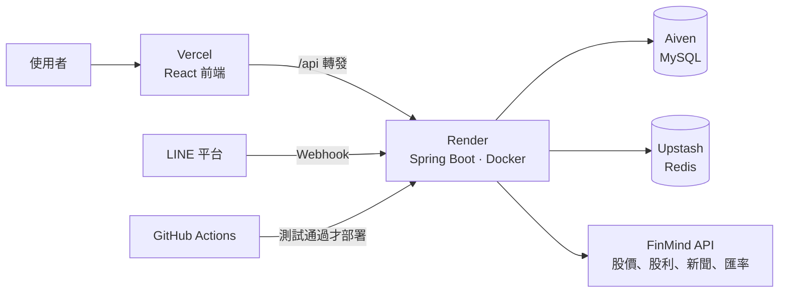

# EZStock

台股、美股的查詢與回測網站：看走勢、比較標的、用條件回測策略、記錄自己的資產，還有論壇和 LINE Bot。

- **網站**：https://ezstock-zeta.vercel.app
- **技術**：React 19 + Vite、Spring Boot 4 + Java 21、MySQL、Redis
- 免費方案部署，後端閒置 15 分鐘會休眠，第一次打開可能要等 1 分鐘左右

> 我原本在飯店業擔任主管，大學時接觸期貨程式交易，有策略想法卻寫不出來，這是我轉職軟體工程師的起點。
> EZStock 是我把「想驗證的投資想法」做成工具的作品，從資料匯入、回測引擎、會員系統到部署都自己完成。

---

## 功能

| 功能 | 說明 |
|---|---|
| **個股查詢** | 台股上市股票與 ETF、美股約 8,000 檔（市值 10 億美元以上的公司與 ETF）。走勢圖（折線／K 線、均線、成交量）、當日開高低、52 週區間、股利紀錄 |
| **市場概況** | 首頁顯示台灣 50、台積電、S&P 500、那斯達克 100 的最新行情與近三個月走勢，加上自選股與熱門股的新聞 |
| **標的比較** | 同一筆錢、同一天買進最多 5 檔，一直抱到今天：期末資產、年化報酬、最大回落、領到的股利 |
| **條件回測** | 設定買進條件（全部成立才買）與賣出條件（任一成立就賣），例如「站上月線買、跌破季線或停損 10% 賣」，跟「一直持有」對照 |
| **條件選股** | 用同一套條件，從自選股或全部股票篩出今天符合的 |
| **我的資產** | 現金、負債、台股與美股持股；美股用臺灣銀行牌告匯率換算成台幣，算出淨資產與未實現損益 |
| **論壇** | 發文、留言、標記股票（顯示即時漲跌），按讚、瀏覽數、熱門／最新排序 |
| **會員** | Email 註冊登入、Google 登入、LINE 登入 |
| **LINE Bot** | 查股價、查資產、到價提醒（例如「提醒 2330 > 1500」），每個交易日 18:00 推播資產與自選股回報 |

回測會計算台股的手續費（可設定折扣）與證交稅、除權息、股票分割與面額變更；美股使用還原股價，以零手續費計算。

---

## 技術架構



| | 使用技術 |
|---|---|
| 前端 | React 19、React Router、Recharts（圖表）、Vite、純 CSS（CSS 變數管理配色） |
| 後端 | Spring Boot 4.1、Java 21（虛擬執行緒、record、sealed interface）、Spring Security、Spring Data JPA、MyBatis |
| 資料庫 | MySQL 8（Flyway 管理資料表版本）、Redis（refresh token、登出黑名單、登入次數限制、快取） |
| 登入 | JWT（RS256）+ HttpOnly Cookie 的 refresh token、Google Identity Services、LINE Login（OAuth 2.0 / OIDC） |
| 部署 | Docker、Render、Vercel、Aiven、Upstash、GitHub Actions、cron-job.org（定時喚醒） |

### 後端分層

```
controller  →  service  →  dao（介面）  →  JPA 實作 ／ MyBatis 實作
                  ↓
             backtest（回測引擎，純 Java，不依賴 Spring）
                  ↓
             datasource（外部資料來源介面，FinMind 是其中一種實作）
```

- **DAO 有 JPA 和 MyBatis 兩種實作**，用設定 `ezstock.dao.type` 切換，同一份測試兩種實作都跑一次，確保行為一樣。
- **回測引擎不依賴 Spring 和資料庫**，輸入價格、股利、分割就能計算，單元測試很好寫。交易成本用 `CostModel` 介面，台股、美股、不計成本各一個實作。
- **外部資料來源抽成介面**，匯入流程只依賴 `MarketDataSource`，之後要換資料來源只要新增實作。

---

## 技術重點

### 資料
- **按需載入**：不一次匯入幾千檔股票的價格，使用者第一次查詢時才去抓，之後收盤後自動補最新資料。同一檔同時被查兩次只會抓一次（每檔一把鎖）。
- **美股還原股價**：資料來源沒有美股的股利、分割資料，所以存還原價。之後只要有除息或分割，過去的價格都會變；每次補資料時比對資料庫最新一天的價格，不一致就整段重抓，避免新舊資料接起來出現假的跳空。
- **新聞**：外部 API 一次只能查一檔、一天。用 Redis 快取、虛擬執行緒並行抓取，並用 Semaphore 限制最多同時 4 個請求，避免被 API 封鎖。

### 安全
- **JWT RS256**：access token 15 分鐘；refresh token 放 HttpOnly、SameSite=Strict 的 Cookie，前端 JavaScript 讀不到，降低 XSS 偷 token 的風險。登出時把 access token 放進 Redis 黑名單。
- **登入次數限制**：同一個 Email 15 分鐘錯 5 次、同一個 IP 錯 20 次就鎖住，回 429 並告訴前端還要等多久。
- **LINE 登入**：state 防 CSRF（Redis + Cookie 雙重比對、只能用一次），nonce 防 ID Token 重放；Email 已註冊時不自動合併帳號，避免帳號被接管。
- **LINE Webhook**：用 channel secret 驗證 HMAC-SHA256 簽章，比對用 constant-time，防止 timing attack。

### 並發與一致性
- **按讚**：`post_like` 主鍵 `(post_id, member_id)` 加 `INSERT IGNORE`，連點兩下、兩個請求同時進來也只算一次；讚數、留言數用 `SET count = count + 1` 原子更新。
- **瀏覽數**：Redis `SET NX` 加 30 分鐘 TTL，同一個人一直重新整理不會灌數字。
- **熱門排序**：參考 Hacker News 的熱度分數（互動量 ÷ 時間衰減），衰減強度依網站流量調整，做成設定值。

### 部署與維運
- **CI/CD**：PR 時 GitHub Actions 開一個臨時的 MySQL、Redis 跑後端測試，前端跑 lint 和 build；合併到 main 而且全部通過後，才用 Deploy Hook 觸發 Render 部署。
- **小記憶體容器**：Render 免費方案只有 512MB，JVM 用 `MaxRAMPercentage`、SerialGC，並縮小執行緒數與連線池。
- **Log**：每個請求有 traceId，錯誤回應也帶 traceId，方便從使用者回報找到對應的 log；Email、LINE userId、token 在 log 裡一律遮罩。

---

## 專案結構

```
EZStock/
├── EZStockApi/                 後端（Spring Boot）
│   ├── src/main/java/com/ezstock/
│   │   ├── backtest/           回測引擎、條件、交易成本
│   │   ├── controller/         REST API
│   │   ├── service/            商業邏輯
│   │   ├── dao/                資料存取介面，jpa/、mybatis/ 兩種實作
│   │   ├── datasource/         外部資料來源（FinMind）
│   │   ├── security/           JWT、Google、LINE 登入、登入次數限制
│   │   ├── line/               LINE Bot、每日推播、到價提醒
│   │   ├── news/               新聞與快取
│   │   └── job/                排程（每日更新股價、每週更新美股清單）
│   ├── src/main/resources/
│   │   ├── db/migration/       Flyway 資料表版本（V1 ~ V13）
│   │   └── mapper/             MyBatis SQL
│   ├── http/                   API 測試檔（IntelliJ HTTP Client）
│   └── Dockerfile
├── ezstock_frontend/           前端（React + Vite）
│   ├── src/pages/              每一頁
│   ├── src/components/         共用元件、圖表
│   ├── src/api/                呼叫後端 API
│   └── vercel.json             /api 轉發到後端
└── .github/workflows/ci.yml    CI / CD
```

---

## 在本機執行

### 需要
- Java 21、Node.js 24
- MySQL 8、Redis
- [FinMind](https://finmindtrade.com/) 的 API token（免費註冊；不填也能用，但每小時的呼叫次數較少）

### 後端
```bash
cd EZStockApi
cp src/main/resources/application.properties.example src/main/resources/application.properties
# 編輯 application.properties：資料庫連線、FinMind token
# 選填：Google、LINE 的設定，沒填就不顯示那個登入方式

./mvnw spring-boot:run
```
- 第一次啟動時 Flyway 會自動建立資料表。
- 股票清單：把 `ezstock.import.run-on-startup` 設成 `true` 啟動一次（會匯入台股清單和設定檔指定的股票），匯完改回 `false`；美股清單在資料庫還沒有美股時會自動匯入。
- 其他股票的價格在第一次查詢時才會抓。

### 前端
```bash
cd ezstock_frontend
npm install
npm run dev
```
打開 http://localhost:5173，開發伺服器會把 `/api` 轉發到 `http://localhost:8080`。

---

## 測試

```bash
cd EZStockApi
./mvnw test        # 約 290 個測試案例，DAO 測試會連本機的 MySQL、Redis

cd ezstock_frontend
npm run lint
npm run build
```

- **單元測試**：回測引擎、交易成本、熱度分數、匯率快取等，用固定的 `Clock` 測試跟時間有關的邏輯。
- **Service 測試**：Mockito 模擬 DAO 和外部 API。
- **外部 API 測試**：`MockRestServiceServer` 模擬 FinMind、LINE 的回應，不連真的網路。
- **DAO 測試**：連真的 MySQL，JPA 和 MyBatis 兩種實作跑同一組測試。
- **Controller 測試**：MockMvc 檢查參數驗證、錯誤格式、登入狀態。

---

## 部署

| 元件 | 平台 | 備註 |
|---|---|---|
| 前端 | Vercel | main 更新後自動部署；`/api/*` 轉發到後端，瀏覽器看起來是同一個網站，Cookie 可以維持 SameSite=Strict，也不用開 CORS |
| 後端 | Render（Docker） | 由 GitHub Actions 在測試通過後觸發部署 |
| MySQL | Aiven | 需要 SSL |
| Redis | Upstash | 需要 TLS（`rediss://`） |

後端需要的環境變數列在 [`application-prod.properties`](EZStockApi/src/main/resources/application-prod.properties) 的開頭。

---

## 已知限制

- 股價是**每日收盤**資料，沒有盤中即時報價。
- 美股使用還原股價，回測等於股利自動再投入，**未扣美股股利 30% 的預扣稅**。
- 資產頁的美股成本用最新匯率換算，**損益不含匯差**（系統不知道買進當時的匯率）。
- 回測未計股利所得稅、二代健保補充保費；權息合併發放的資料無法拆出現金股利，目前略過。
- 免費方案的限制：後端閒置會休眠、FinMind 免費額度每小時有上限。

---

## 作者

**YC**　轉職中的後端工程師（Java / Spring Boot）
